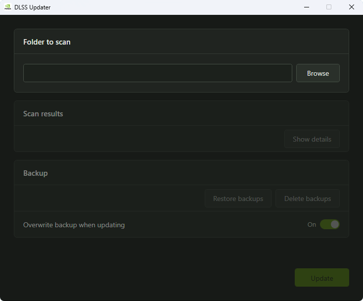

# DLSS Updater

A simple desktop tool for finding and updating NVIDIA DLSS files in your game folders, rebuilt in C# for Windows.

The C#/.NET Framework version keeps the executable lightweight at around 60 KB, compared with around 10 MB for the Python build.


---

## Links

- Website: https://www.dlssupdater.com
- GitHub: https://github.com/sparepillowgit/dlss-updater-dotnet
- Latest Release: https://github.com/sparepillowgit/dlss-updater-dotnet/releases/latest

---

## Features

- Recursively scans a selected game folder
- Detects:
  - `nvngx_dlss.dll`
  - `nvngx_dlssg.dll`
  - `nvngx_dlssd.dll`
- Compares installed versions against the latest supported release
- Updates files only when a newer version is available
- Automatically creates per-file backups before updating
- Choose whether an existing backup is overwritten during an update
- Restore original files from backups at any time

---

## Screenshot



---

## Download

Download the latest version:

https://github.com/sparepillowgit/dlss-updater-dotnet/releases/latest

- Portable (no installation required)
- Requires .NET Framework 4.8 (included with Windows 10 version 1903 or later and Windows 11)

---

## Usage

1. Launch the application
2. Enter or paste a game folder, or click **Browse** to select one
3. Wait for the folder scan to finish
4. Click **Update** to update supported DLSS files

---

## Notes

- Updating protected game folders may require running as **Administrator**
- Only files with a newer available version will be replaced
- Backups are stored beside the original files as `.dubackup.zip` files
- The backup overwrite setting controls whether an existing backup is replaced during an update
- Some games rely on specific DLSS versions. If issues occur, restore backups or verify your game files through your launcher

---

## FAQ

**What are DLSS files?**  
DLSS files are NVIDIA libraries used by supported games for features like AI upscaling, frame generation, and ray reconstruction. Files such as `nvngx_dlss.dll` are bundled with games and can sometimes be updated for better performance or image quality.

**How does DLSS Updater work?**  
It scans a selected game folder, detects DLSS files, and updates them when newer versions are available.

**"But you can swap DLSS files with the NVIDIA App now, why do I need this?"**  
DLSS Updater exists for people who don't want a ~170 MB application and its background processes just to manage a few DLSS files. It's a small tool that does one job and then gets out of the way. I'm not a fan of software accumulating features until a simple utility turns into an entire platform. Not everything needs to be bundled into an app that manages your games, runs in the background, collects usage data, and does a dozen other things you never asked for.

**Why choose this over DLSS Swapper or other similar apps?**  
Other apps offer more features, but DLSS Updater focuses on simplicity. It's a lightweight, no-setup tool that quickly scans your game folders and updates DLSS files without extra integrations or background processes.

**Does it require installation?**  
No. DLSS Updater is a portable tool and can be run directly from a folder or USB drive. .NET Framework 4.8 is included with Windows 10 version 1903 or later and Windows 11.

**Can updating DLSS files break my game?**  
Yes. Updating DLSS can cause issues in some games. Restore the original file or verify game files through your launcher (Steam, etc.) if this happens.

**Why did my antivirus flag DLSS Updater?**  
This can happen because the tool downloads and replaces files, behaviour similar to some malware, which may trigger heuristic detection. The source code is available for review, and downloads should be obtained from the official source.

---

## Development

### Build From Source

#### Requirements

- Windows
- Visual Studio with the .NET Framework 4.8 targeting pack, or MSBuild with the targeting pack installed

#### Build Command

Run from a Visual Studio Developer Command Prompt or Developer PowerShell:

```powershell
msbuild dlss-updater.csproj /t:Build /p:Configuration=Release
```

#### Output

The built application will be created in:

```text
bin\Release\
```

Run the executable:

```text
bin\Release\dlss-updater.exe
```
